# Práctica 3 — Puerta Inteligente IoT

## 1. Portada

| Dato | Información |
|---|---|
| Asignatura | SIS-234 |
| Título | Puerta inteligente IoT con ESP32, RFID-RC522, SG90 y AWS IoT Core |
| Institución y carrera | Ingenieria de Sistemas - Universidad Catolica Boliviana  |
| Integrantes y grupo | Leonardo Guillermo Köller, Ariel Jesus Mamani, Luis Felipe Velasco |
| Fecha del documento | 10 de noviembre de 2026 |
| Repositorio publicado | https://github.com/JesusxAriel/Practica3_Alexa_Aws_ESP32.git |
| Estado de la entrega | Integración AWS–Alexa comprobada; nueva ampliación RFID local compilada, pendiente de evidencia de prueba física; evidencias visuales parciales incorporadas |

Este informe describe el código y los resultados funcionales observados en AWS y Alexa Developer Console. No se reproducen archivos privados, certificados ni claves. Se distinguen los flujos probados, las limitaciones detectadas y los anexos documentales todavía por adjuntar.

## 2. Resumen

Se documenta un prototipo académico de puerta inteligente que utiliza un ESP32 para registrar lecturas de un RFID-RC522 y ejecutar órdenes de bloqueo y desbloqueo mediante un servomotor SG90. La tarjeta autorizada solicita desbloqueo local y el llavero autorizado bloqueo, reutilizando el controlador existente. Se conserva la comunicación remota MQTT/TLS con AWS IoT Core y Device Shadow clásico. El dispositivo publica lecturas y estado comandado, recibe órdenes remotas y reconcilia las órdenes RFID pendientes con desired y reported.

El backend Python incorpora clases para consultar y actualizar el Shadow y para vincular usuarios con dispositivos mediante DynamoDB. La skill Custom de Alexa en español de España fue creada, compilada, enlazada a AWS Lambda y probada en Alexa Developer Console. Se verificaron la invocación, la vinculación con DynamoDB, la consulta del estado del cerrojo, la consulta del contador RFID y el envío de una orden de bloqueo. También se observó movimiento del SG90 después de recuperar la conectividad Wi-Fi del ESP32. Durante el ajuste del modelo se detectó confusión en algunas frases de apertura y cierre; finalmente se comprobó el desbloqueo con «quita el seguro» y el bloqueo con «bloquea la cerradura», ambos con movimiento observado del SG90. Otras expresiones todavía pueden clasificarse incorrectamente.

El registro de limpieza documenta una compilación satisfactoria y ocho pruebas unitarias aprobadas. Estos resultados respaldan la construcción del software y determinados comportamientos del backend. Las interacciones observadas en Alexa Developer Console aportan además evidencia funcional de integración, aunque no constituyen mediciones de precisión mecánica, estabilidad o tiempos de respuesta. El prototipo no mide la apertura física de la puerta ni confirma la posición alcanzada por el servo.

**Palabras clave:** ESP32, RFID, SG90, MQTT/TLS, Device Shadow, AWS Lambda, DynamoDB, Alexa.

## 3. Introducción

La integración de sensores, actuadores y servicios en la nube permite estudiar cómo un dispositivo embebido intercambia información con un backend remoto. El RFID registra eventos y genera órdenes locales para dos UID autorizados; el SG90 representa un cerrojo controlado localmente y desde AWS. Los UID desconocidos se registran sin generar movimiento. La autorización por UID es una demostración académica, no autenticación criptográfica.

El Device Shadow mantiene la separación entre la intención de control y el estado comunicado por el dispositivo. El backend escribe `desired.cerrojo`; el ESP32 procesa la orden y posteriormente actualiza `reported.cerrojo`. Esta distinción permite describir el control remoto sin confundir una solicitud con una confirmación mecánica.

En la ampliación RFID, una orden local pendiente prevalece hasta comprobar por GET que desired y reported coinciden. Se conserva en RAM al reconectar, no tras reinicio. Después se aceptan órdenes remotas normalmente. Los conflictos y pruebas se detallan en [CONTROL_RFID_LOCAL.md](CONTROL_RFID_LOCAL.md). Las pruebas previas de Alexa no demuestran la validación de esta ampliación.

El alcance se determinó mediante inspección de README, AGENTS, registro de limpieza, fuentes C++, plantilla pública de configuración, backend Python, modelo Alexa, pruebas y documentación local. El borrador previo contenía referencias a un sensor Reed y a funciones retiradas. La documentación final se ajusta al montaje RC522 + SG90. No se ha supuesto una configuración desplegada a partir de las plantillas ni se ha auditado la cuenta AWS.

## 4. Objetivos

### 4.1. Objetivo general

Documentar el diseño y la implementación de un prototipo de puerta inteligente que registra lecturas RFID y ejecuta órdenes de cerrojo mediante ESP32 y AWS IoT Core, estableciendo el alcance comprobado y las limitaciones de su integración.

### 4.2. Objetivos específicos

- Describir el cableado y la función del RC522 y del SG90 según el código actual.
- Explicar la organización modular del firmware y su comunicación bidireccional con AWS.
- Documentar el contrato del Shadow, la resolución de dispositivos por usuario y el backend Python.
- Describir la integración efectuada con Alexa y los resultados de pruebas ejecutadas, diferenciando los comandos validados de las variantes de reconocimiento no fiables.
- Relacionar resultados locales, pruebas declaradas y evidencias pendientes.
- Identificar las limitaciones mecánicas, de persistencia y de validación del prototipo.

### 4.3. Trazabilidad del alcance

La numeración siguiente conserva la referencia RF1–RF9 del borrador anterior. No reemplaza el enunciado oficial de la práctica: el archivo `Práctica_3.md` citado por ese borrador no está disponible entre las fuentes revisadas. Por ello, no se declara cumplimiento normativo completo.

| Referencia heredada | Alcance observable en la versión actual | Situación |
|---|---|---|
| RF1, monitoreo de sensores | Lecturas RC522, clasificación y contador | Implementado; no incluye medición física de apertura |
| RF2, reporte | Reporte por cambio y respaldo configurado de 5 s | Implementado con condiciones; periodicidad real por medir |
| RF3, actuador y Shadow | Aplicación de delta y desired recuperado; reporte del comando | Implementado; sin confirmación mecánica |
| RF4, consulta de apertura | `EstadoPuertaIntent` conserva lectura de un campo heredado | No respaldado por el hardware actual |
| RF5, bloqueo/desbloqueo | Intents escriben `desired.cerrojo` | Implementado; comandos fiables de bloqueo y desbloqueo comprobados con movimiento observado |
| RF6, consulta de cerrojo | Consulta `reported.cerrojo` | Implementado; responde sobre el estado de software |
| RF7, vinculación | Código, validación de Thing y persistencia por usuario | Implementado y cubierto parcialmente por pruebas locales |
| RF8, usuario sin vinculación | Respuesta que solicita vincular un dispositivo | Comprobado mediante prueba unitaria |
| RF9, gestión de vinculación | Validación, sustitución por nueva vinculación y eliminación | Implementado; cobertura automatizada parcial |

## 5. Materiales y herramientas

| Elemento | Uso documentado | Fuente o precisión |
|---|---|---|
| ESP32 DevKit V1 | Procesamiento, Wi-Fi, SPI y señal del servo | Placa `esp32doit-devkit-v1` en PlatformIO |
| RFID-RC522 | Único sensor: lectura e identificación local | Biblioteca MFRC522 y bus SPI |
| Tarjeta y llavero RFID | Objetos comparados con dos UID configurados | Identificadores conservados en firmware; no se reproducen aquí |
| SG90 | Único actuador: representación del cerrojo | Consignas de posición, no rotación continua |
| Alimentación USB/5 V disponible en el montaje | Alimentación utilizada durante las pruebas del SG90 | Sin medición de corriente; fuente externa regulada recomendada para una versión robusta |
| USB, conexiones y masa común | Alimentación del ESP32 y montaje | Fotografías parciales adjuntas; falta vista total con alimentación identificable |
| PlatformIO y Arduino | Construcción del firmware C++ | Entorno principal único |
| Python y unittest | Backend y pruebas aisladas | Limpieza validada con Python 3.11 de PlatformIO |
| AWS IoT Core y Device Shadow | Intercambio de órdenes y reportes | MQTT/TLS, puerto 8883 en firmware |
| AWS Lambda y boto3 | Gestión de eventos y APIs AWS | Inicialización de clientes al crear el controlador |
| DynamoDB | Asociación código–Thing y usuario–Thing | Tabla con partición `pk` de tipo String |
| Alexa Skills Kit | Interfaz de voz | Skill Custom es-ES creada, compilada y vinculada a Lambda; pruebas funcionales realizadas |

Las dependencias declaradas son Espressif32 `6.5.0`, PubSubClient `^2.8`, ArduinoJson `^7.0.0`, MFRC522 `^1.4.10` y ESP32Servo `1.1.0`. Las restricciones con `^` permiten versiones compatibles; no deben presentarse como un bloqueo exacto de todas las dependencias. El registro de limpieza no documenta una actualización de bibliotecas.

## 6. Arquitectura general del sistema

### 6.1. Componentes y responsabilidades

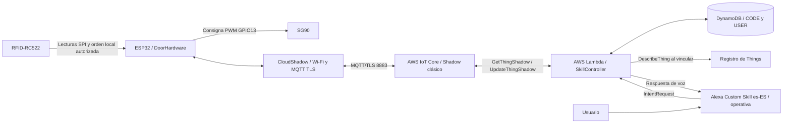

Las conexiones representan la arquitectura implementada. La ruta Alexa → Lambda → AWS IoT Core fue utilizada en pruebas de la consola de desarrollo. El diagrama no representa una certificación de despliegue comercial ni una medida de disponibilidad continua.

`DoorHardware` concentra la interacción con el lector y el servo. `CloudShadow` administra red, TLS, MQTT, suscripciones y reportes. En Lambda, `SkillController` procesa solicitudes; `LinkRepository` accede a DynamoDB y `ShadowGateway` opera sobre AWS IoT. Se mantiene un ESP32 por Thing y cada usuario resuelve su dispositivo mediante su registro de vinculación.

### 6.2. Flujo bidireccional de órdenes y estado

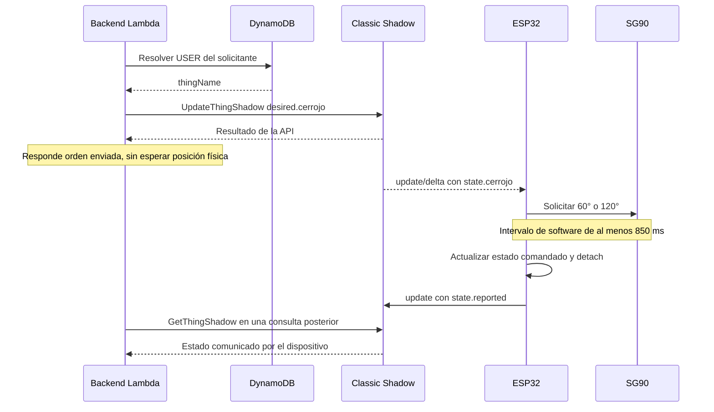

El sentido AWS → ESP32 transporta órdenes. El sentido ESP32 → AWS comunica lecturas y estados de software. La respuesta inicial de Lambda no espera la finalización del servo; una consulta posterior obtiene el último reporte disponible, cuya antigüedad no es evaluada por el controlador actual.

## 7. Diseño del hardware

### 7.1. Distribución de pines

| Dispositivo | Señal | ESP32 |
|---|---|---|
| RC522 | SDA / SS | GPIO21 |
| RC522 | RST | GPIO22 |
| RC522 | SCK | GPIO18 |
| RC522 | MISO | GPIO19 |
| RC522 | MOSI | GPIO23 |
| RC522 | Alimentación | 3V3 y GND |
| SG90 | Señal | GPIO13 |
| SG90 | Alimentación | 5 V del montaje de prueba y masa común; fuente externa recomendada |

No se incluye un sensor Reed ni otra entrada de apertura física. Los GPIO proceden de la plantilla pública y del uso de sus constantes en el código; el cableado real debe demostrarse con fotografías.

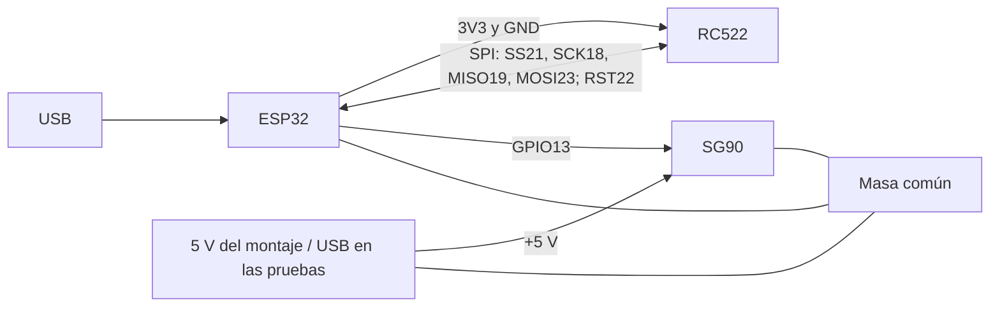

### 7.2. Control y alimentación

El firmware configura 50 Hz y un rango de pulsos de 500 a 2400 µs. La orden de bloqueo solicita 60° y la de desbloqueo 120°, definidos en `DoorHardware.cpp`. Al iniciar se escribe 90° y se conserva `desconocido` como estado. Esa inicialización no garantiza que el mecanismo esté bloqueado ni constituye una comprobación de seguridad física.

Tras el intervalo de comando, `detach()` suspende la generación de pulsos; no desconecta la alimentación. Tampoco demuestra mantenimiento de fuerza o posición bajo carga. Durante las pruebas el SG90 recibió alimentación desde el montaje basado en USB/ESP32; no se midieron corriente ni precisión angular. Para un funcionamiento con carga se recomienda una fuente de 5 V regulada apropiada y masa común, sin alimentarlo desde 3V3.

**Evidencia E01 — Fotografías del montaje compartidas durante el desarrollo:**

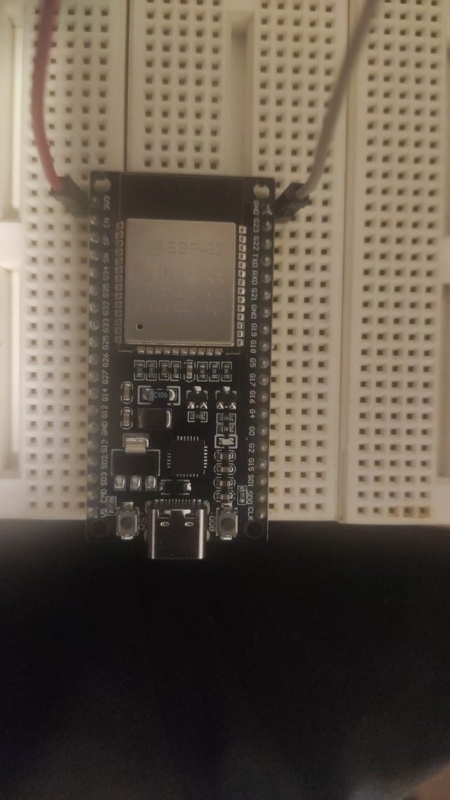

*Figura E01-A. Fotografía real del ESP32 durante el armado. No permite verificar por sí sola la alimentación de todos los componentes.*

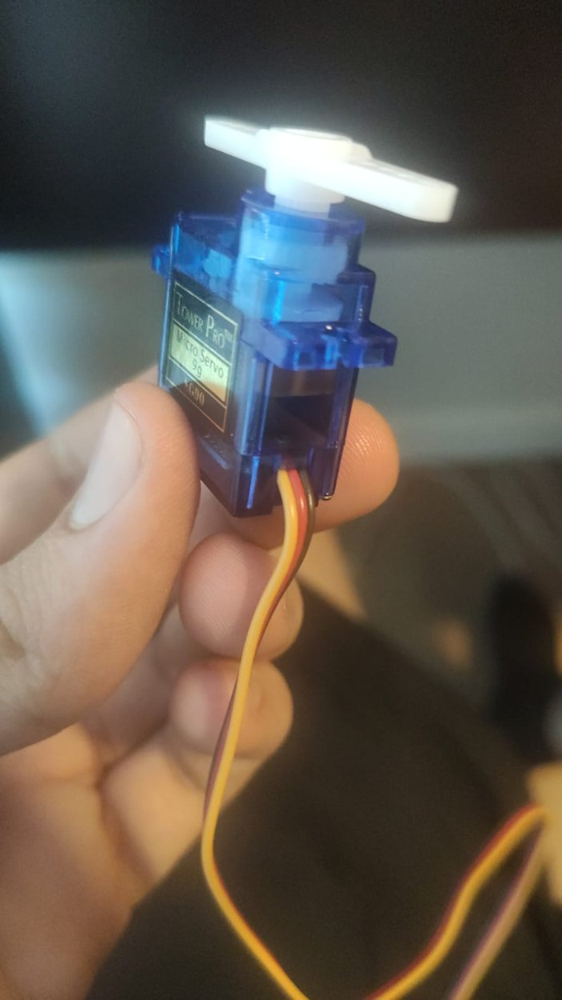

*Figura E01-B. Fotografía del SG90 utilizado en las pruebas. Falta una vista general del circuito completo.*

## 8. Desarrollo del firmware

### 8.1. Organización modular

| Archivo | Responsabilidad |
|---|---|
| `src/main.cpp` | Inicia Serial a 115200, hardware y nube; ejecuta actualizaciones y una pausa de 5 ms |
| `src/DoorHardware.h/.cpp` | Inicialización RC522, contador, clasificación y gestión del comando SG90 |
| `src/CloudShadow.h/.cpp` | Wi-Fi, sincronización horaria, TLS, MQTT y contrato Shadow |
| `include/config.example.h` | Plantilla pública de nombres de configuración y pines, sin valores privados reales |
| `platformio.ini` | Placa, framework, bibliotecas y opciones del entorno de producción |

### 8.2. Registro RFID

La inicialización ejecuta `PCD_Init()` y consulta `VersionReg`. Un resultado distinto de `0x00` y `0xFF` establece `rfid_available=true`. Esta comprobación se realiza al iniciar y no representa un diagnóstico continuo del lector.

Se sondea presencia mediante `PICC_WakeupA()` cada 150 ms, incluso para una tarjeta en HALT. Se suprime la repetición del mismo UID hasta observar al menos 750 ms sin respuesta; los errores distintos de timeout no se interpretan como retirada. Se conserva un mínimo de 1200 ms entre lecturas aceptadas. Un UID distinto puede constituir otra presentación. Tras cada selección correcta se ejecutan `PICC_HaltA()` y `PCD_StopCrypto1()`, también para repeticiones suprimidas.

Cada lectura aceptada incrementa el contador y se compara con los dos UID configurados. `ultimoRFID` mantiene `tarjeta`, `llavero` o `desconocido`, inicialmente `ninguno`. La tarjeta solicita `desbloqueada` (120°), el llavero `bloqueada` (60°), y un UID desconocido no genera orden.

La clasificación autoriza las dos acciones locales descritas a través de `requestLockState()`, sin un segundo controlador PWM. El contador vive en RAM y se reinicia con el ESP32; representa presentaciones aceptadas, no personas distintas ni tarjetas únicas. La supresión de repeticiones debe validarse frente a ruido y pérdidas prolongadas de presencia RF.

**Evidencia E02 — Reconocimiento de los UID durante las pruebas:**

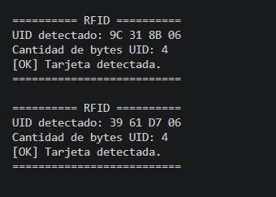

*Figura E02. Captura de detección RFID compartida previamente; acredita identificación, no la ejecución de la ampliación local más reciente.*

### 8.3. Máquina de comando del servo

`requestLockState()` acepta únicamente `bloqueada` y `desbloqueada`. Si el estado coincide estando detenido, o el objetivo coincide estando en movimiento, no repite el comando ni reinicia su intervalo. En otro caso solicita el ángulo correspondiente, registra el instante inicial y marca movimiento pendiente. RFID y AWS utilizan este mismo método.

`update()` finaliza el comando cuando han transcurrido al menos 850 ms, asigna el estado objetivo, llama a `detach()` y comunica un cambio a la capa de nube. El tiempo efectivo depende de la ejecución del bucle; 850 ms no es una medición de llegada física. Durante un comando, una nueva orden válida puede sustituir el objetivo y reiniciar su intervalo.

### 8.4. Gestión de red y publicación

El código habilita reconexión Wi-Fi e intenta recuperarla con una separación configurada de 5 s. Antes de MQTT exige que el reloj supere el umbral implementado y solicita NTP con reintentos de 4 s. Los intentos MQTT se separan al menos 3 s según el control del programa. Esos intervalos no son tiempos máximos de reconexión.

Después de conectar se mantienen las suscripciones existentes y se publica `/get` con `clientToken` para correlacionar la respuesta. Se reintenta con umbral de 8 s. Sin orden local pendiente se aplica desired recuperado; si existe una orden RFID pendiente, se conserva y se reconcilia primero. Durante el movimiento se difiere el reporte. El respaldo de 5 s no conserva una cola histórica de lecturas.

`mqtt_.publish()` se usa sin solicitar QoS 1 y su éxito no confirma almacenamiento. Para RFID se consulta la versión, se envían desired y reported en una actualización condicionada y se comprueba mediante otro GET que ambos coinciden. Solo entonces, con el comando finalizado, se libera la prioridad local. Un conflicto o desconexión conserva la orden pendiente en RAM y permite reintentos. Se mantienen los tópicos, sin `/update/accepted`; los reportes ordinarios no tienen confirmación individual. La nueva reconciliación requiere pruebas reales.

## 9. Integración con AWS IoT Core

### 9.1. Conexión y tópicos

Se utiliza el endpoint configurado localmente, TLS con CA, certificado y clave del dispositivo y puerto 8883. El nombre del Thing también identifica al cliente MQTT. Este informe no reproduce los valores privados ni afirma haber verificado su contenido.

| Operación | Tópico, relativo a `$aws/things/THING_NAME/shadow` | Uso |
|---|---|---|
| Publicación | `/get` | Recuperar el documento al conectar y reintentar sincronización |
| Publicación | `/update` | Comunicar `state.reported` |
| Suscripción | `/update/delta` | Aplicar `state.cerrojo` de la diferencia |
| Suscripción | `/get/accepted` | Aplicar `state.desired.cerrojo` recuperado |
| Suscripción | `/get/rejected` | Salir de la espera y tratar de reportar |
| Suscripción | `/update/rejected` | Registrar rechazo de actualización |

Ante `/get/rejected`, 404 permite intentar crear el Shadow; otros errores conservan la espera y sus reintentos. Los deltas con versión ya observada se descartan. Un GET anterior a un delta más reciente provoca otra consulta. Este manejo no constituye una prueba de recuperación exitosa.

### 9.2. Contrato de datos

| Propiedad | Valores o tipo | Semántica |
|---|---|---|
| `desired.cerrojo` | `bloqueada`, `desbloqueada` | Orden remota o reconciliación de orden RFID local |
| `reported.cerrojo` | `desconocido`, `bloqueada`, `desbloqueada` | Estado del comando en software |
| `reported.tarjetasLeidas` | Entero no negativo | Lecturas aceptadas desde el reinicio |
| `reported.ultimoRFID` | `ninguno`, `tarjeta`, `llavero`, `desconocido` | Última clasificación local |
| `reported.rfid_available` | Booleano | Resultado del reconocimiento inicial del RC522 |

Los campos de la tabla se ubican dentro de `state`. El mensaje de delta tiene una forma distinta del documento completo: la orden llega como `state.cerrojo`, no como `state.desired.cerrojo`. La publicación de RFID no incluye UID.

Ejemplo ilustrativo de orden, no evidencia de una ejecución:

```json
{"state":{"desired":{"cerrojo":"desbloqueada"}}}
```

Ejemplo ilustrativo de reporte posterior a la finalización del comando:

```json
{
  "state": {
    "reported": {
      "cerrojo": "desbloqueada",
      "tarjetasLeidas": 2,
      "ultimoRFID": "llavero",
      "rfid_available": true
    }
  }
}
```

El valor 2 es didáctico; no se presenta como un resultado del hardware. La plantilla `aws/shadow-example.json` se actualizó documentalmente para representar las propiedades actuales. No se aplicó a un recurso AWS.

### 9.3. Despliegue y seguridad

Las plantillas locales describen permisos IoT para un Thing y su cliente, acceso del firmware a los tópicos enumerados y permisos de Lambda para `DescribeThing`, Shadow y operaciones de DynamoDB. Requieren sustituir marcadores de región, cuenta y dispositivo antes de un despliegue autorizado; su presencia no demuestra que las políticas reales coincidan.

Las guías describen la asociación del certificado activo al Thing, el endpoint y los permisos del backend. No se inspeccionaron estos recursos durante la documentación. No se utilizaron brokers públicos ni se sustituyó AWS por otro canal.

**Evidencias E03 y E04 por anexar:** capturas anonimizadas del Thing y políticas y, de estar disponible, secuencia `desired` → delta recibido → `reported`. La conectividad y el envío de órdenes se comprobaron durante la integración; no adjuntar certificados, claves o configuración privada.

## 10. Implementación de AWS Lambda y DynamoDB

### 10.1. Estructura del backend

| Componente | Función |
|---|---|
| `LinkRepository` | Consulta catálogo por código; resuelve, crea y elimina vinculaciones por usuario |
| `ShadowGateway` | Valida nombres y existencia de Things; lee `reported`; escribe órdenes en `desired` |
| `SkillController` | Interpreta solicitudes Alexa y genera respuestas en español |
| `create_controller()` | Crea tabla y clientes boto3 a partir de `TABLE_NAME` e `IOT_DATA_ENDPOINT` |
| `lambda_handler()` | Reutiliza el controlador entre invocaciones del mismo entorno |

El handler esperado es `lambda_function.lambda_handler`. El endpoint admite configuración con o sin prefijo `https://`, que el código normaliza. Las pruebas usan sustitutos de los servicios; no necesitan crear estos clientes ni conectarse a AWS.

### 10.2. Persistencia y vinculación

| Clave de partición `pk` | Contenido | Origen |
|---|---|---|
| `CODE#<seis_dígitos>` | `thingName` | Catálogo preparado para la demostración |
| `USER#<userId>` | `thingName`, `fechaVinculacion` | Registro creado por el backend |

El código debe contener seis cifras y no comenzar por cero. Al vincular, el backend busca el código, valida el patrón del nombre del Thing, ejecuta `DescribeThing` y persiste la relación con fecha UTC. Una nueva vinculación del mismo usuario sustituye su relación anterior; desvincular elimina el registro de usuario, no el Thing ni el catálogo.

La identidad se obtiene de `context.System.user.userId` y, como alternativa, de `session.user.userId`. Un usuario sin relación no puede acceder a los comandos protegidos por esta resolución. Cada usuario tiene una relación en la tabla, pero el código no impide que varios usuarios vinculen el mismo Thing mediante un código compartido.

### 10.3. Consultas y órdenes

Las órdenes de bloqueo y desbloqueo escriben exclusivamente `state.desired.cerrojo`. La respuesta indica que se envió una orden y no espera el reporte del ESP32. La consulta del cerrojo obtiene el último `reported.cerrojo`; la consulta RFID utiliza `tarjetasLeidas`. No se realiza una validación de antigüedad del dato.

`EstadoPuertaIntent` sigue consultando `reported.puerta` por compatibilidad. Si no hay un valor reconocido, informa falta de lectura. Si permanece un valor histórico `abierta` o `cerrada` en el Shadow, podría responder con ese dato aunque el firmware actual no lo produzca. Las actualizaciones de las otras propiedades no eliminan automáticamente ese campo. No se modificó el Shadow desplegado para corregirlo.

**Evidencias E05 y E06:** se realizaron pruebas directas de Lambda e invocaciones reales desde Alexa Developer Console; deben diferenciarse. Se adjunta una captura de los dos desencadenadores Alexa asociados a la misma función Lambda. No sustituye una captura de los registros DynamoDB ni de la respuesta de una invocación.

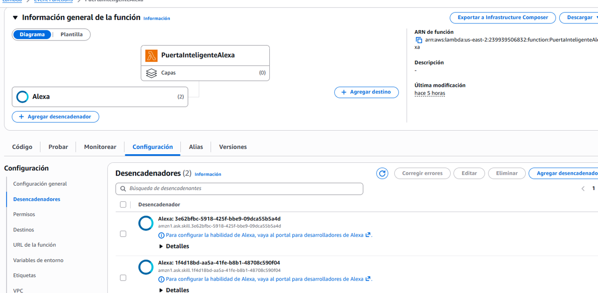

*Figura E05. Configuración de AWS Lambda con dos desencadenadores de Alexa Skills Kit, después de conectar la segunda Skill.*

## 11. Integración implementada con Alexa

La skill Custom **Puerta Inteligente SIS234**, con nombre de invocación **«puerta conectada»** y lenguaje `es-ES`, fue creada y compilada en Alexa Developer Console. Se configuró como endpoint la función AWS Lambda `PuertaInteligenteAlexa` desplegada en `us-east-2`, y se autorizó su invocación mediante un trigger Alexa Skills Kit asociado a la skill. La integración se probó desde el simulador en modo **Development**.

| Intent | Función | Resultado de integración |
|---|---|---|
| `VincularIntent` | Asociar código de seis cifras con usuario Alexa y Thing mediante DynamoDB | **Comprobado:** respuesta «Puerta vinculada correctamente. Ya puedes consultarla o controlarla» |
| `EstadoCerrojoIntent` | Consultar `reported.cerrojo` | **Comprobado:** Alexa respondió «La cerradura está desbloqueada» y, posteriormente, «La cerradura está bloqueada» |
| `LecturasRfidIntent` | Consultar `tarjetasLeidas` | **Comprobado:** «El lector ha registrado 0 lecturas desde el último reinicio» |
| `BloquearIntent` | Solicitar `desired.cerrojo=bloqueada` | **Comprobado en Alexa:** «bloquea la cerradura» identificó `BloquearIntent` y produjo movimiento del SG90 en la prueba final |
| `DesbloquearIntent` | Solicitar `desired.cerrojo=desbloqueada` | **Comprobado en Alexa:** «quita el seguro» identificó `DesbloquearIntent` y produjo movimiento del SG90; otras variantes se confundieron |
| `DesvincularIntent` | Eliminar vinculación del usuario | Implementado y probado con dobles; sin evidencia de invocación desde simulador |
| `EstadoPuertaIntent` | Consultar campo heredado de apertura | Conservado por compatibilidad; no representa medición física actual |
| Intents `AMAZON.*` | Ayuda, detener, cancelar y fallback | Incluidos en el modelo |

### 11.1. Comandos utilizados

| Objetivo | Ejemplo de frase en el simulador |
|---|---|
| Abrir la skill | `abre puerta conectada` |
| Vincular | `dile a puerta conectada que vincule la puerta con el código [código de demostración]` |
| Consultar cerradura | `pregunta a puerta conectada cuál es el estado de la cerradura` |
| Consultar lecturas | `pregunta a puerta conectada cuántas tarjetas se han leído` |
| Bloquear (frase validada) | `dile a puerta conectada que bloquee la cerradura` |
| Desbloquear (frase validada) | `dile a puerta conectada que quite el seguro` |

El código de vinculación se omite en la versión de entrega porque es una credencial de demostración compartible. La respuesta inicial de la skill fue: «Bienvenido a Puerta Conectada. Puedes vincular una puerta, consultar su estado o bloquear la cerradura».

### 11.2. Incidencia de reconocimiento y alcance de la prueba

Durante una prueba con la variante «pide a puerta conectada que abra el cerrojo», `request.intent.name` se registró como **`BloquearIntent`**, aunque el modelo contiene la frase «abre el cerrojo» dentro de `DesbloquearIntent`. Esta observación **no prueba que el actuador o Lambda ejecuten incorrectamente un intent reconocido**: señala un problema de clasificación del lenguaje natural en esa invocación. Se revisaron frases y se compiló un nuevo modelo. Las pruebas posteriores confirmaron que «quita el seguro» fue reconocido como `DesbloquearIntent` y «bloquea la cerradura» como `BloquearIntent`, con movimientos observados en los dos sentidos. La expresión «pon el seguro» se confundió con desbloqueo, y las variantes «abre el cerrojo» y «desbloquea la cerradura» no fueron fiables. No se afirma que todas las frases sinónimas funcionen.

En una primera prueba el servo no se movió porque el ESP32 perdió la conexión con el hotspot. Se restableció la conectividad y, en una prueba posterior, se observó movimiento para desbloqueo y bloqueo por voz. No se midieron ángulos físicos ni resistencia mecánica.

**Evidencia E07 — Capturas seleccionadas del simulador y la consola:**

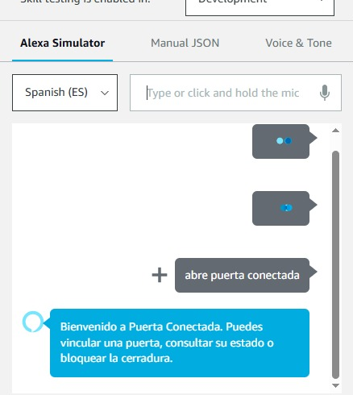

*Figura E07-A. Invocación y respuesta de bienvenida de Alexa.*

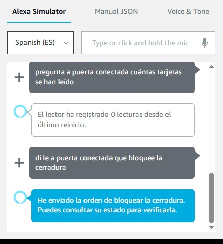

*Figura E07-B. Consulta del contador RFID y confirmación de envío de bloqueo.*

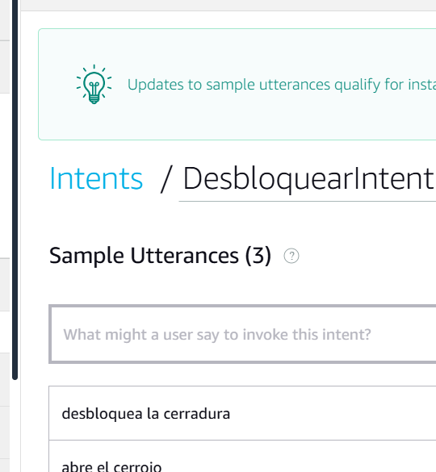

*Figura E07-C. Configuración de frases de `DesbloquearIntent`. La captura de configuración no demuestra por sí sola la clasificación correcta.*

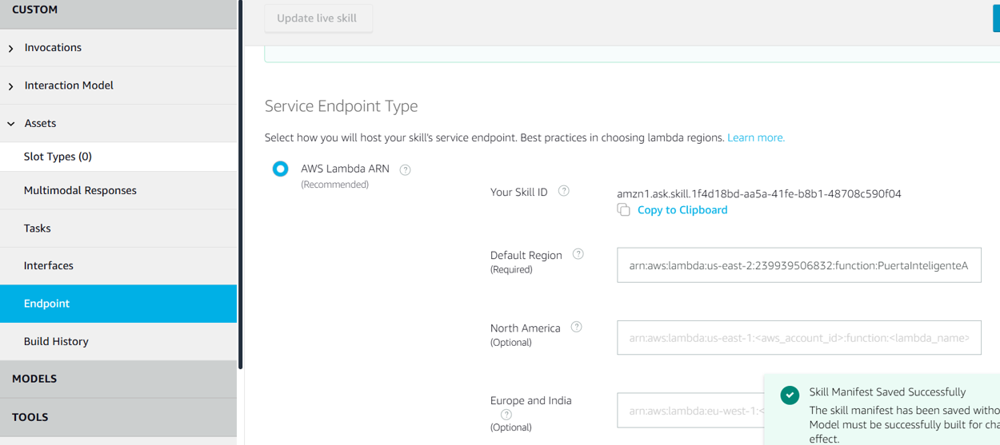

*Figura E07-D. Confirmación de guardado del endpoint de la Skill.*

**Nota:** en las pruebas posteriores el equipo observó movimiento del SG90 para desbloqueo y bloqueo, pero no se compartió un video o captura que documente por sí sola ambos movimientos. Se presenta ese resultado como observación del equipo y no como prueba fotográfica incorporada.

## 12. Pruebas realizadas y resultados

### 12.1. Criterio de clasificación

Se distinguen: implementación observada en archivos; resultados registrados de herramientas; pruebas de hardware o nube declaradas por el equipo sin anexos; y pruebas pendientes. Una inspección de código no prueba ejecución física, y una prueba con dobles no demuestra conectividad con AWS.

### 12.2. Resultados locales registrados

La fuente es `REGISTRO_LIMPIEZA.md`, correspondiente a la limpieza del 10/11/2026. No se presentan como nuevas mediciones tomadas durante la redacción. Los resultados reales de Alexa se registran separadamente en la sección 12.6.

| Comprobación | Resultado documentado | Alcance y límite |
|---|---|---|
| Compilación `esp32doit-devkit-v1` | SUCCESS | Construcción local; no carga ni ejecución en ESP32 |
| Uso de RAM informado por el build | 45 672 bytes; 13,9 % | Informe de construcción, no máximo medido durante operación |
| Uso de flash informado por el build | 910 473 bytes; 69,5 % | Tamaño de imagen respecto de la capacidad de programa indicada |
| unittest | Ocho pruebas aprobadas | Backend con servicios simulados |
| Sintaxis Python | Válida | No comprueba permisos ni recursos AWS |
| Modelo Alexa JSON | JSON válido e intents presentes | No equivale a Build Model en Alexa Developer |
| Referencias de producción | Sin referencias a diagnósticos retirados ni `doorState()` | Comprobación de limpieza |

Se registró una advertencia en `esp32-hal-uart.c` del core Arduino por retorno sin valor. La compilación concluyó correctamente y no se alteró esa dependencia. La revisión de secretos descrita por el registro fue parcial; no constituye una auditoría completa. Al no existir `.git` en la carpeta de limpieza, no fue posible revisar el historial ni los secretos previamente versionados.

### 12.3. Cobertura de las ocho pruebas automatizadas

| Prueba de `tests/test_lambda.py` | Comportamiento comprobado |
|---|---|
| `test_unlinked_user_is_guided` | Usuario no vinculado recibe orientación |
| `test_link_then_check_door` | Vinculación y consulta de un dato simulado de apertura |
| `test_two_users_do_not_share_binding` | Un segundo usuario no hereda la vinculación del primero |
| `test_open_command_only_updates_desired` | Desbloqueo cambia desired y no modifica el reported simulado |
| `test_unlink` | Eliminación del registro del usuario |
| `test_invalid_code` | Rechazo de código inválido |
| `test_missing_code` | Rechazo de código ausente |
| `test_rfid_count` | Respuesta basada en contador simulado |

El campo `puerta=cerrada` de `FakeData` es una fixture histórica, no una lectura del montaje. Las pruebas no cubren exhaustivamente todos los intents, errores de AWS, cambios de dispositivo, desconexiones o casos de datos antiguos.

### 12.4. Pruebas declaradas y anexos faltantes

El contexto del equipo, recogido en README, declara los siguientes ensayos satisfactorios. Se incorporaron algunas capturas de hardware y de la consola, pero no documentan por sí solas todos los pasos de cada ensayo; en la tabla siguiente se indican las pruebas complementarias que permitirían sustentarlos.

| Ensayo declarado | Evidencia necesaria para sustentarlo |
|---|---|
| Conexión Wi-Fi y autenticación con AWS IoT Core | Registro serial y captura de conexión anonimizados |
| Lectura de tarjeta y llavero | Registro de clasificación, incremento del contador y fotografía |
| Publicación de lecturas en Shadow | Captura de las propiedades y correlación con una lectura |
| Recepción de bloqueo y desbloqueo y ejecución de órdenes SG90 | Secuencia desired/delta/reported y video del comando, sin atribuir precisión angular |
| Consulta de RFID y cerrojo desde Lambda | Evento y respuesta anonimizados contrastados con reported |
| Envío de órdenes desde Lambda | Evento y actualización desired correspondiente |
| Vinculación de usuario de prueba en DynamoDB | Registro USER anonimizado y relación con Thing de demostración |

No se dispone de una campaña de mediciones reproducibles de latencia, exactitud angular, estabilidad continua o tiempo de reconexión. Los valores 5 s, 850 ms y 1200 ms descritos en el firmware son parámetros, no resultados experimentales.

### 12.5. Plan de validación pendiente

| Ensayo | Procedimiento propuesto | Registro requerido |
|---|---|---|
| Sincronización tras desconexión | Interrumpir red, cambiar desired y restablecer conexión | GET, desired aplicado y reported, con marcas temporales |
| Permanencia en operación | Definir y ejecutar una duración de ensayo y secuencia de lecturas | Reinicios, fallos y observaciones durante todo el período |
| Latencia de orden | Correlacionar envío, recepción y fin de comando con metodología explícita | Muestras, condiciones y tiempos; sin inventar promedios |
| Estado sin realimentación | Contrastar orden, reported y observación externa | Separar posición solicitada de posición medida, si hubiera medición |
| Reconocimiento de variantes Alexa | Mantener y evaluar frases no fiables separadamente de los dos comandos aprobados | Nuevas capturas por variante, sin tokens ni identificadores personales |

Estos ensayos ampliados son recomendaciones de validación adicional y no impiden describir el prototipo como funcionalmente implementado. Los resultados que se agreguen deberán indicar fecha, responsable, método, condiciones y evidencia.

### 12.6. Pruebas reales de integración AWS y Alexa (10/11/2026)

Las siguientes pruebas fueron realizadas durante la configuración de AWS Lambda, DynamoDB, AWS IoT Core y la consola Alexa Developer. Se registran respuestas observadas, no valores inventados ni resultados de ensayos no ejecutados.

| ID | Prueba | Resultado observado | Estado |
|---|---|---|---|
| IA-01 | Abrir `puerta conectada` | Alexa respondió con el mensaje de bienvenida | Comprobada |
| IA-02 | Vincular dispositivo con código de demostración | «Puerta vinculada correctamente. Ya puedes consultarla o controlarla» | Comprobada |
| IA-03 | Consultar estado del cerrojo | Respuesta «La cerradura está desbloqueada»; en otra consulta «bloqueada» | Comprobada como lectura del Shadow |
| IA-04 | Consultar contador RFID | «El lector ha registrado 0 lecturas desde el último reinicio» | Comprobada; valor dependiente del reinicio |
| IA-05 | Bloquear mediante Alexa | «Bloquea la cerradura» → `BloquearIntent`; orden enviada y movimiento observado en prueba final | Comprobada funcionalmente; sin sensor de ángulo |
| IA-06 | Recuperación de conectividad ESP32 | El equipo identificó desconexión del hotspot y observó movimiento del servo al reconectar | Observación funcional, sin registro cronometrado |
| IA-07 | Variantes de apertura | «Abre el cerrojo» y «desbloquea la cerradura» se clasificaron como `BloquearIntent` durante pruebas | Incidencia de lenguaje natural; no usar esas frases en la demostración |
| IA-08 | Desbloqueo desde Lambda | Orden `desired=desbloqueada` y mensaje serie del servo a 120° observados en prueba previa | Comprobada desde Lambda |
| IA-09 | Desbloquear mediante Alexa | «Quita el seguro» → `DesbloquearIntent`; Alexa anunció desbloqueo y el servo se movió | Comprobada funcionalmente |
| IA-10 | Bloquear después del desbloqueo | «Bloquea la cerradura» → `BloquearIntent`; el servo se movió y la consulta posterior reportó `bloqueada` | Comprobada funcionalmente |

En las pruebas directas de Lambda se observaron respuestas correctas de consulta y envío de órdenes, pero también duraciones próximas a ocho segundos en varias invocaciones. No se realizaron suficientes mediciones controladas para reportar un promedio de latencia o garantizar cumplimiento de un tiempo máximo. El hecho de que una respuesta de Alexa indique «orden enviada» **no demuestra por sí mismo** que el actuador completó físicamente el movimiento.

### 12.7. Ampliación posterior: control RFID local

La versión ampliada recompiló satisfactoriamente en `esp32doit-devkit-v1`: RAM 45 768 bytes (14,0 %) y flash 914 801 bytes (69,8 %). Se ejecutaron nuevamente las ocho pruebas existentes de Lambda, todas aprobadas. Estos resultados son distintos del build anterior registrado en 12.2. El registro de Codex no acredita upload ni pruebas de hardware o AWS de esta ampliación; en esta revisión no se recibió una salida nueva del monitor que confirme la ejecución física con RFID local. El plan de tarjeta, llavero, tarjeta sostenida, conflictos, reconexión y Alexa se encuentra en [CONTROL_RFID_LOCAL.md](CONTROL_RFID_LOCAL.md) y requiere evidencias específicas del nuevo comportamiento RFID local.

## 13. Problemas encontrados y soluciones aplicadas

| Problema o discrepancia | Acción documentada | Situación |
|---|---|---|
| Seis diagnósticos y entornos temporales junto al firmware | Retirados en limpieza, con copia previa | Queda únicamente el entorno principal |
| `doorState()` sin usuarios y constantes antiguas | Eliminados durante limpieza | No cambia el contrato actual publicado |
| Include duplicado y comentarios redundantes | Limpieza mínima | Clases y módulos conservados |
| Documentos describían Reed y ángulos de otra versión | Actualización de README, guías, AGENTS y ejemplo local | Hardware documentado como RC522 + SG90, 60°/120° |
| Borrador de informe desactualizado | Sustitución por `docs/informe.md` | Contenido ajustado al código y evidencias pendientes |
| Comando Python del sistema no ejecutable | Uso de Python del entorno PlatformIO durante limpieza | Ocho pruebas registradas como aprobadas |
| Restricción de permisos en caché PlatformIO | Compilación autorizada con acceso a su caché durante limpieza | Build final satisfactorio |
| Advertencia en core Arduino | Conservación de la dependencia y registro de advertencia | No resuelta en código externo |
| Acceso a Amazon Developer | Se resolvió el acceso y se creó/compiló la skill | Integración de Alexa realizada y probada |
| Confusión entre frases de apertura y bloqueo | Se ajustó el modelo y se identificaron frases fiables («quita el seguro» / «bloquea la cerradura») | Control en ambas direcciones comprobado; sinónimos aún no fiables |
| ESP32 desconectado del hotspot durante orden de Alexa | Se recuperó la conexión Wi-Fi del dispositivo | El equipo observó movimiento del SG90 al restablecerse la conectividad |
| Sin repositorio Git en la carpeta revisada | Copias locales de recuperación; sin commits ni push | Historial no auditable desde esta carpeta |

La copia documental anterior está en `.cleanup-backups/documentacion-antes-20261110.zip`, excluida del versionado. `REGISTRO_LIMPIEZA.md` conserva las decisiones de la tarea previa y un apartado posterior de actualización documental. No se cambiaron fuentes funcionales, identificadores RFID, tópicos, pines, certificados, configuración privada o recursos AWS para redactar este informe.

## 14. Limitaciones del prototipo

- **Posición y apertura:** no hay realimentación externa del servo ni sensor de apertura. `reported.cerrojo` no confirma un pestillo físico y `EstadoPuertaIntent` puede consultar datos históricos no producidos actualmente.
- **Persistencia:** contador, clasificación y orden RFID pendiente viven en RAM y se pierden al reiniciar. La orden pendiente sí se conserva durante una desconexión sin reinicio; no existe historial de lecturas.
- **Conflictos local/remoto:** una orden RFID pendiente prevalece hasta comprobar desired/reported coincidentes, incluso ante una orden remota opuesta durante la desconexión. No hay orden cronológico global garantizado. Una nueva presentación autorizada reemplaza la orden local pendiente; tras la convergencia vuelve a aceptarse control remoto.
- **Autorización RFID:** comparar UID no protege frente a clonación. La detección de retirada y la convivencia RFID/AWS requieren ensayos sobre hardware de esta versión.
- **Diagnóstico:** `rfid_available` solo se determina al inicio. No se implementa recuperación continua del lector desconectado después del arranque.
- **Entrega y actualidad:** no existe una confirmación de cada reporte aceptado por el Shadow ni comprobación de antigüedad de las consultas. Una pérdida de conectividad puede dejar datos desactualizados.
- **Vinculación:** los códigos son compartibles; no se observa caducidad, uso único, límite de intentos ni exclusividad de propietario. Dos usuarios pueden vincular el mismo Thing si conocen el código.
- **Validación:** los tests locales usan dobles; adicionalmente se ejecutaron pruebas reales en AWS y Alexa. Falta adjuntar capturas al informe y realizar ensayos instrumentados de fallos y mediciones reproducibles.
- **Alexa:** las dos órdenes principales de voz se comprobaron con movimiento observado del SG90. Algunas frases alternativas aún pueden confundirse; no se probaron todos los intents ni todas las formulaciones posibles.
- **Seguridad física:** la alimentación y el mecanismo no cuentan con ensayos de carga, consumo o retención incorporados. El prototipo no debe utilizarse como cerradura de seguridad.

Como trabajo futuro se recomienda incorporar realimentación si se necesita conocer posición real, definir tratamiento de datos antiguos, ampliar pruebas de errores y reconexión, y fortalecer el ciclo de vida de los códigos. Estas medidas no forman parte de la implementación actual y no se aplicaron durante la documentación.

## 15. Conclusiones

El repositorio conserva el registro RFID y el control remoto del SG90, y añade órdenes locales autorizadas mediante el mismo controlador no bloqueante. La reconciliación del Shadow establece prioridad temporal local y distingue publicación de comprobación posterior. Las clases existentes conservan sus responsabilidades de hardware, transporte, persistencia y procesamiento de solicitudes. Esta ampliación no modifica Lambda, DynamoDB ni el modelo Alexa y requiere comprobar su convivencia sobre el montaje real.

La compilación satisfactoria y las ocho pruebas unitarias registradas respaldan la construcción del firmware y una parte del comportamiento del backend. No permiten concluir que se cumplieron metas de latencia, estabilidad o precisión física. Las pruebas de hardware y AWS declaradas por el equipo requieren los anexos indicados para su evaluación académica.

La integración con Alexa se verificó funcionalmente en Alexa Developer Console para invocación, vinculación, consulta del cerrojo, consulta RFID y las órdenes fiables de desbloqueo y bloqueo; se observó movimiento del SG90 en ambos sentidos. El estado del cerrojo sigue siendo una representación de software, no una medida física. Queda documentada la clasificación incorrecta de algunas frases alternativas, sin que esto invalide los dos comandos que funcionaron. La incorporación de capturas y datos administrativos es una tarea de presentación, no una funcionalidad de software por implementar.

## 16. Referencias técnicas

### 16.1. Fuentes primarias del repositorio

| Fuente | Información utilizada |
|---|---|
| [README](../README.md) y [AGENTS](../AGENTS.md) | Alcance y restricciones de mantenimiento |
| [Registro de limpieza](../REGISTRO_LIMPIEZA.md) | Cambios finales y resultados locales registrados |
| [Control RFID local](CONTROL_RFID_LOCAL.md) | Política de conflictos y pruebas de la ampliación |
| [PlatformIO](../firmware/platformio.ini) | Placa, framework y dependencias |
| [DoorHardware.cpp](../firmware/src/DoorHardware.cpp) y [cabecera](../firmware/src/DoorHardware.h) | RFID, temporización y consignas del SG90 |
| [CloudShadow.cpp](../firmware/src/CloudShadow.cpp) y [cabecera](../firmware/src/CloudShadow.h) | MQTT/TLS, sincronización y reportes |
| [main.cpp](../firmware/src/main.cpp) | Inicialización y bucle principal |
| [Plantilla pública](../firmware/include/config.example.h) | Pines y configuración esperada, sin datos privados |
| [Backend Lambda](../lambda/lambda_function.py) | Clases, contratos y respuestas |
| [Modelo Alexa](../alexa/interaction-model.es-ES.json) | Intents, slot y frases previstas |
| [Pruebas unitarias](../tests/test_lambda.py) | Casos realmente presentes en la suite |
| [Guía de armado](GUIA_ARMADO.md) y [guía AWS/Alexa](GUIA_AWS_ALEXA.md) | Procedimientos y preparación de despliegue |
| [Plantilla de Shadow](../aws/shadow-example.json), [política IoT](../aws/iot-policy.example.json), [política Lambda](../aws/lambda-iam-policy.example.json) y [esquema DynamoDB](../aws/dynamodb-schema.example.json) | Ejemplos locales, no configuración real auditada |

### 16.2. Enlaces técnicos presentes en la documentación base

Se conservan los enlaces oficiales que ya figuraban en el repositorio, como material de consulta. No se atribuyen a estas páginas resultados experimentales ni se afirma una revisión externa durante esta tarea, basada en fuentes locales.

- AWS, [Device Shadow MQTT topics](https://docs.aws.amazon.com/iot/latest/developerguide/device-shadow-mqtt.html).
- AWS, [Device Shadow service documents and communication](https://docs.aws.amazon.com/iot/latest/developerguide/device-shadow-comms-device.html).
- AWS, [Device communication protocols](https://docs.aws.amazon.com/iot/latest/developerguide/protocols.html).
- Amazon Developer, [Steps to build a custom skill](https://developer.amazon.com/en-US/docs/alexa/custom-skills/steps-to-build-a-custom-skill.html).
- Boto3, [IoTDataPlane.Client.get_thing_shadow](https://docs.aws.amazon.com/boto3/latest/reference/services/iot-data/client/get_thing_shadow.html).

## 17. Anexos y evidencias

### 17.1. Inventario de anexos documentales

Los identificadores siguientes organizan la documentación visual del proyecto. Este informe incorpora una selección de fotografías y capturas auténticas proporcionadas durante el trabajo. Algunas capturas se recortaron para reducir la exposición de datos de cuenta. Cada imagen demuestra solo lo visible; la ausencia de una captura de una prueba no significa que se haya realizado con evidencia adjunta.

| ID | Ubicación en el informe | Estado de evidencia |
|---|---|---|
| E01 | Sección 7 | **Adjuntas parcialmente**: fotografías del montaje y del SG90; falta una vista global que documente toda la alimentación |
| E02 | Secciones 8 y 12 | **Adjunta parcialmente**: captura de identificación RFID; falta monitor con movimientos por RFID local de la versión nueva |
| E03 | Sección 9 | Thing, conectividad y permisos anonimizados; sin certificados ni claves |
| E04 | Secciones 6 y 9 | Secuencia de orden AWS, delta recibido y reported posterior |
| E05 | Sección 10 | **Adjunta parcialmente**: configuración de disparadores Lambda; las invocaciones detalladas no están incorporadas en esta selección |
| E06 | Sección 10 | Vinculación de usuario de prueba en DynamoDB, anonimizada |
| E07 | Secciones 11 y 12 | **Adjuntas parcialmente**: bienvenida, consulta RFID, bloqueo, configuración de modelo y endpoint; falta evidencia visual de ambos movimientos físicos |
| E08 | Sección 12 | Salidas completas del build y de las ocho pruebas; el resumen está registrado |
| E09 | Sección 12 | Ensayos de estabilidad, latencia y reconexión con método y condiciones |

Cada anexo deberá incluir título, fecha, responsable, procedimiento y una descripción breve de lo que demuestra. Anonimizar identificadores de usuario, datos de cuenta y cualquier información privada. No adjuntar `config.h`, archivos de certificados, claves, contraseñas ni tokens. Un video de movimiento no prueba por sí solo el ángulo alcanzado.

### 17.2. Relación de archivos de evidencia incorporados

Las imágenes de este paquete se encuentran en `docs/evidencias/`. Para que aparezcan al publicar el Markdown, conservar el árbol de carpetas al subirlo al repositorio. No publicar capturas completas de JSON Input que contengan `apiAccessToken`.

### 17.3. Reproducción de comprobaciones locales

Desde la raíz, con Python disponible:

```powershell
python -m unittest discover -s tests -v
```

Desde `firmware/`, con PlatformIO y configuración local ya preparada:

```powershell
pio run -e esp32doit-devkit-v1
```

Estos comandos son instrucciones de reproducción. La compilación no carga el dispositivo y las pruebas unitarias no invocan Lambda real. Las capturas de herramientas deben mostrar resultado y contexto suficiente sin divulgar secretos.

### 17.4. Datos administrativos pendientes

Los integrantes y el repositorio ya están identificados. Faltan institución/carrera, docente, grupo formal y atribución de contribuciones verificables. Las evidencias físicas de la ampliación RFID y las mediciones de rendimiento siguen sin documentarse; no se inventan.
